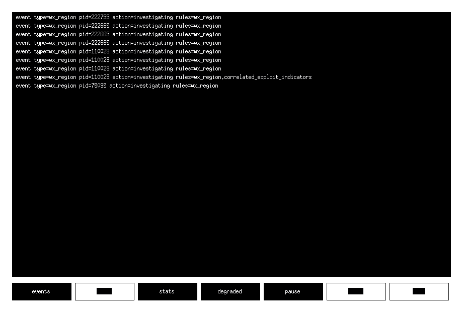

# ap
> [!WARNING]
> This is just a research project with limited coverage, not a complete product or some serious shit.

* event-driven exploit protection engine.
* by the way, this is an upgraded version of a project i built a while ago
  
build `make`  
check `make check`  
sanitize `make asan`  
bench `make bench`

run `./out/ap --json --verbose --socket /tmp/ap.sock --store ap.jsonl`  
verify `./out/ap --verify-store ap.jsonl`  
seal `./out/ap --seal-policy ap.policy` then `./out/ap --policy ap.policy`  
bundle `./out/ap --seal-update bundle.manifest` then `./out/ap --verify-update bundle.manifest`  
approve `./out/ap --seal-update bundle.manifest --require-approval` then `./out/ap --activation-plan /tmp/ap-install --require-approval`  
stage `./out/ap --stage-update bundle.manifest /tmp/ap-stage`  
client key `./out/ap --client-key 1234:/tmp/ap-client.key` (repeatable, at most 16)  
audit `./out/ap --audit-process --audit-key /tmp/ap-audit.key --socket /tmp/ap.sock --store ap.jsonl`  
replay `./out/ap --json --verbose --once --no-proc-scan --kernel-events events.apk1`  
kernel `./out/ap --json --kernel-sensor` (degrades cleanly without bpf or perf privileges)  
guard `./out/ap --guard --deny wx_transition --threshold 10 --trace /path/to/program`  
mini gui `./out/apgui` (raw X11, white frame, black event area, buttons `1` events, `2` guard, `3` stats, `4` degraded, `c` clear, `q` quit)

approval is local possession, not vendor identity; the plan is read-only. `--trace` consumes all remaining arguments. docs in `docs/`.
